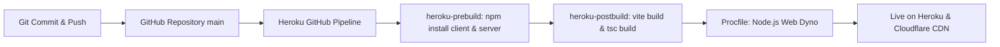

# 📚 Tricity Bookstall (Ekatva Foundation) — Full-Stack Web Application

[](https://tricity-bookstall-app-e81d6b4e4211.herokuapp.com/)
[](https://github.com/rajakumar270/TricityBookstall)
[](https://cloudflare.com)
[](https://react.dev)
[](https://nestjs.com)

A high-performance full-stack web application for **Ekatva Foundation’s Tricity Bookstall Initiative**. The platform brings transformative philosophical books, youth character literature, kids value education, and reflective dialogues to schools, colleges, and communities across **Chandigarh, Mohali, and Panchkula**.

---

## 🌐 Live Deployments & URLs

| Service | Environment / Provider | Link / Status |
| :--- | :--- | :--- |
| **Heroku App** | Production Dyno | [https://tricity-bookstall-app-e81d6b4e4211.herokuapp.com/](https://tricity-bookstall-app-e81d6b4e4211.herokuapp.com/) |
| **Custom Domain** | Cloudflare DNS & Registrar | Configured with Cloudflare Edge SSL & Proxy |
| **GitHub Repository** | Continuous Integration / CD | [github.com/rajakumar270/TricityBookstall](https://github.com/rajakumar270/TricityBookstall) |

---

## 🌟 Key Application Features

* **📖 Curated Books Catalog:** Full-featured searchable catalog with filtering by category (*Kids Wisdom, Vedanta & Classics, Mind & Character, Self Discovery*), search keywords, and stock status.
* **🎈 Bal Prabodhanam (Kids Wisdom Corner):** Interactive moral stories, children’s philosophical books, and daily wisdom quotes.
* **📸 Campus Events & Stalls:** Showcase of previous bookstalls and campus fests (*Panjab University Sector 14, CGC University Mohali, Doon Public School Panchkula, Indradhanush Auditorium*).
* **🏛️ Institutional Stall Booking:** Instant request portal for schools, colleges, and cultural events to invite a free bookstall.
* **📄 Online Document Viewer:** In-app PDF reader and instant downloads for the official **Book Catalogue** and **Campus Collaboration Brochure**.
* **🛡️ Secret Admin Portal (`/admin` or `/portal`):** Complete management of books, stall requests, events gallery, CMS content blocks, and real-time site branding.

---

## 📂 Architecture & Directory Structure

This repository uses a **unified full-stack architecture** where the NestJS backend builds and serves the compiled React frontend directly, allowing zero-latency API calls and a single Heroku web dyno deployment:

```text
TricityBookstall/
├── Procfile                    # Heroku Web process declaration (cd server && npm run start:prod)
├── package.json                # Root orchestration scripts (heroku-prebuild & heroku-postbuild)
├── README.md                   # Documentation
│
├── client/                     # React 18 + Vite Frontend
│   ├── src/
│   │   ├── components/         # Modular UI (Navbar, Hero, DownloadsSection, EventsV2, AdminDashboard, etc.)
│   │   ├── services/api.js     # Axios API service (auto-resolves localhost vs. Heroku production API)
│   │   ├── App.jsx             # Root React view with lazy loading & code splitting
│   │   └── main.jsx            # Application entry point
│   ├── public/assets/          # Brand logos, brochures, and event photos
│   ├── vite.config.js          # Vite build config with manual chunk splitting
│   └── package.json
│
└── server/                     # NestJS 10 REST API Backend
    ├── src/
    │   ├── books/              # Books CRUD controller & service
    │   ├── bookings/           # Institutional stall invitations controller
    │   ├── events/             # Campus events controller & service
    │   ├── cms/                # Dynamic CMS block editor service
    │   ├── settings/           # Site settings & dynamic branding
    │   ├── database/           # MySQL Connection Pool (JawsDB / ClearDB / Local)
    │   ├── auth/               # Admin authentication service
    │   ├── app.module.ts       # NestJS root module
    │   └── main.ts             # App bootstrap, CORS, and React static SPA hosting
    ├── schema.sql              # Database schema migrations
    └── package.json
```

---

## 💻 Local Development Setup

### Prerequisites
* **Node.js** (v18.x or v20.x recommended)
* **npm** (v9.x or higher)
* **MySQL** (optional for local testing; SQLite / fallback defaults are included for offline rendering)

---

### Step 1: Clone the Repository
```bash
git clone https://github.com/rajakumar270/TricityBookstall.git
cd TricityBookstall
```

---

### Step 2: Configure Environment Variables

**Server Configuration (`server/.env`):**
```env
PORT=5001
DB_HOST=localhost
DB_PORT=3306
DB_USER=root
DB_PASSWORD=your_mysql_password
DB_NAME=ekatva_bookstall_db
```

**Client Configuration (`client/.env`):**
```env
VITE_API_URL=http://localhost:5001/api
```

---

### Step 3: Run the Application

#### Option A: Running Development Mode (Recommended for code changes)

1. **Start the NestJS Backend** (Terminal 1):
   ```bash
   cd server
   npm install
   npm run start:dev
   ```
   * REST API will run at: `http://localhost:5001/api`

2. **Start the React Frontend** (Terminal 2):
   ```bash
   cd client
   npm install
   npm run dev
   ```
   * Web App will open at: `http://localhost:5173` (or `http://localhost:3000`)

---

#### Option B: Running Unified Production Build Locally (Mirrors Heroku)

To test the unified production build exactly as Heroku executes it:
```bash
# 1. Install all dependencies and build both client & server
npm run heroku-prebuild
npm run heroku-postbuild

# 2. Run production server
npm start
```
* Access the entire unified app (frontend + API) at `http://localhost:5001`!

---

### 🛡️ Admin Portal Access
* URL: Navigate to `http://localhost:5173/admin` (or `/portal`, or click the Shield icon in the UI)
* Default credentials:
  * **Username:** `admin`
  * **Password:** `admin123`

---

## 🚀 Continuous Deployment (GitHub Pipeline ➡️ Heroku)

The repository is configured for automated CI/CD directly from GitHub to Heroku.



### 1. How the Pipeline Works
1. Every push to the `main` branch on GitHub automatically triggers a build on Heroku through the **Heroku GitHub Integration**.
2. **`heroku-prebuild`** runs:
   ```bash
   cd client && npm install && cd ../server && npm install
   ```
3. **`heroku-postbuild`** packages the application:
   ```bash
   cd client && npm run build && cd ../server && npm run build
   ```
4. **`Procfile`** starts the optimized NestJS server:
   ```procfile
   web: cd server && npm run start:prod
   ```
5. The NestJS server boots up, binds to Heroku's `$PORT`, connects to the MySQL database, and serves the React bundle from `client/dist`.

### 2. Heroku Configuration Variables (Config Vars)
In the Heroku Dashboard (**Settings > Config Vars**), verify the following:
* `DATABASE_URL` or `JAWSDB_URL`: MySQL database connection string.
* `NODE_ENV`: `production`

---

## ☁️ Cloudflare Custom Domain Configuration

The domain is purchased and managed via **Cloudflare**. Follow these steps to map your Cloudflare domain to the Heroku production application:

### Step 1: Add the Domain in Heroku
Using the Heroku CLI or Dashboard (**Settings > Domains**):
```bash
heroku domains:add yourdomain.com -a tricity-bookstall-app
heroku domains:add www.yourdomain.com -a tricity-bookstall-app
```
Heroku will provide unique DNS targets (e.g., `whispering-mountain-xxxx.herokudns.com`).

---

### Step 2: Configure DNS Records in Cloudflare
Log in to your [Cloudflare Dashboard](https://dash.cloudflare.com/), navigate to your domain's **DNS > Records**, and create the following:

| Type | Name | Target / Content | Proxy Status | TTL |
| :--- | :--- | :--- | :--- | :--- |
| **CNAME** | `@` (root) | `your-root-target.herokudns.com` | **Proxied (Orange Cloud)** | Auto |
| **CNAME** | `www` | `your-www-target.herokudns.com` | **Proxied (Orange Cloud)** | Auto |

> [!NOTE]
> Cloudflare automatically supports **CNAME Flattening** for root (`@`) domains, so you do not need static IP A-records.

---

### Step 3: Configure Cloudflare SSL/TLS & HTTPS
1. In the Cloudflare sidebar, navigate to **SSL/TLS**:
   * Set SSL mode to **Full** (or **Full (strict)**) to ensure secure HTTPS encryption between Cloudflare and Heroku.
2. Under **SSL/TLS > Edge Certificates**:
   * Turn **ON** **Always Use HTTPS** (redirects all `http://` traffic to `https://`).
   * Turn **ON** **Automatic HTTPS Rewrites**.
3. Under **Rules / Page Rules** (Optional):
   * Add a redirect rule if you want to forward `www.yourdomain.com` to `yourdomain.com` (or vice-versa).

---

## 🛠️ Tech Stack & Libraries

* **Frontend:** React 18, Vite 5, Tailwind CSS, Lucide React, Framer Motion, Canvas Confetti.
* **Backend:** NestJS 10, Express, TypeScript, `mysql2` connection pooling.
* **Cloud & Infrastructure:** Heroku (Web Dyno & Buildpacks), Cloudflare (DNS, SSL, Edge Caching, Registrar).
* **CI/CD:** GitHub Pipeline with automated Heroku deployment on branch push.

---

## 📜 Maintenance & Useful Commands

```bash
# Check Heroku live logs
heroku logs --tail -a tricity-bookstall-app

# Restart Heroku Dyno
heroku restart -a tricity-bookstall-app

# Inspect database schema or run migration script
cd server && npm run migrate:mysql
```

---

© 2026 **Ekatva Foundation**. Nurturing Clarity, Character & Wisdom across Tricity.
